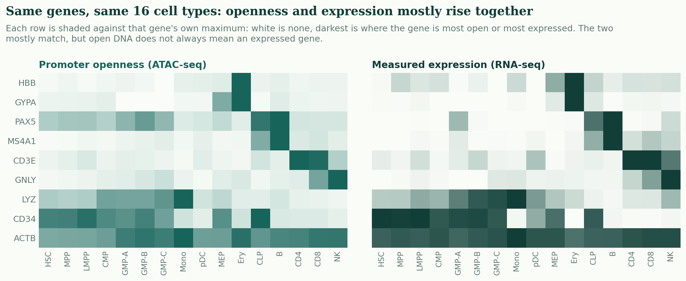
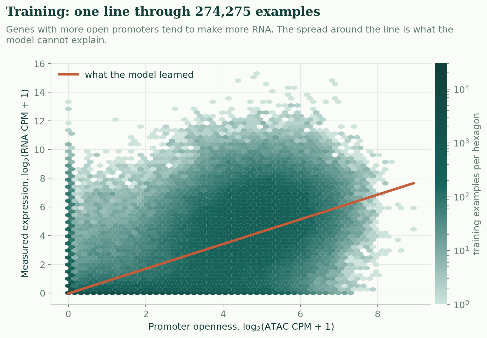
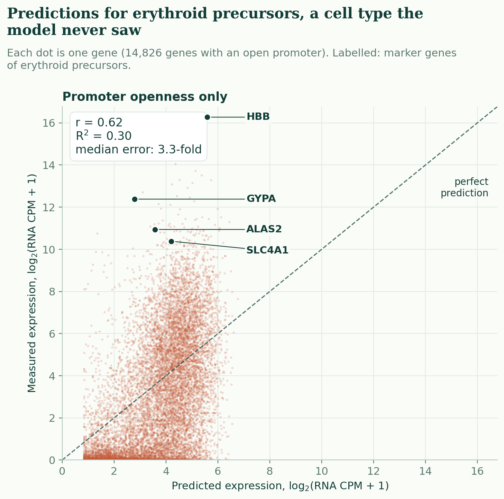
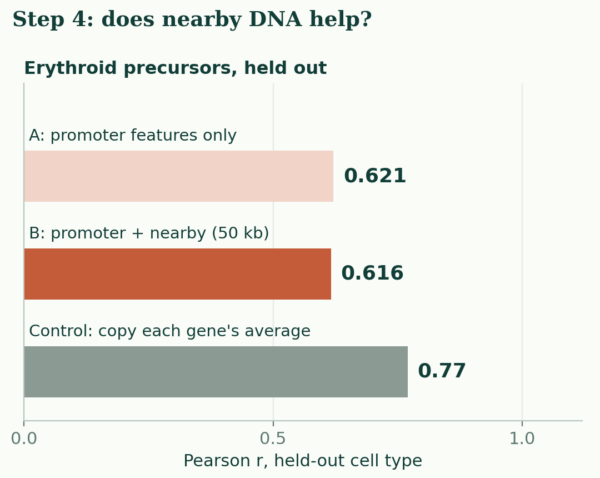
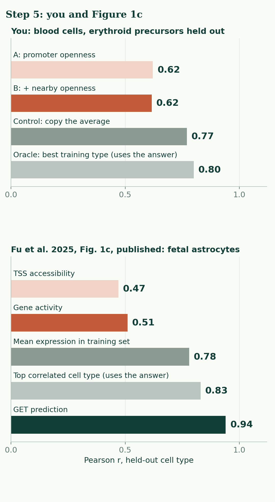

# NEBULA LAB: build your own gene expression predictor

Can a computer predict how strongly genes are expressed using regulatory information? This Colab notebook lets you try it in five short steps, on real measurements from human blood cells. It accompanies the KAUST B224 journal club on GET (Fu *et al.*, *Nature* 2025).

[](https://colab.research.google.com/github/almokhtar8-stack/nebula-lab/blob/main/NEBULA_Lab.ipynb)

Open the notebook with the button above, sign in with any Google account, and run the five numbered cells from top to bottom: press ▶ beside each cell, or Shift + Enter. If Colab warns that the notebook was not authored by Google, choose Run anyway.

On a phone or without a Google account, scroll down: every result is shown below.

The model here is a simplified teaching model, not the GET foundation model.

## The five steps

These are the outputs of the notebook run in a local Jupyter kernel with Colab-era package versions. The analysis is deterministic, so every run gives the same numbers.

### ① Data: 16 kinds of human blood cells
How open the DNA is around each gene (ATAC-seq) and how much RNA it makes (RNA-seq), for 18,285 genes in 16 cell types.



### ② Train: one straight line
Erythroid precursors are hidden. A straight line learns, from the other 15 cell types, how promoter openness relates to expression.



### ③ Predict: a cell type the model never saw
On the 14,826 genes with an open promoter, r = 0.62: the predictions rise with the measurements. But 70% of the genes fall below the dashed line, because the model guesses too high.



### ④ Experiment: add nearby regulatory DNA
Option B adds the openness of all other open regions within 50 kb of the gene's start sites. It makes no meaningful difference (0.621 to 0.616). Copying each gene's average from the training cell types beats both models (0.77).



[Full step 4 figure](assets/stages/step4.png)

### ⑤ Discover: meet GET
Figure 1c of the paper shows the same ordering. Accessibility alone (0.47, 0.51) loses to copying the average (0.78), and GET (0.94) is the only real predictor above it. The top correlated cell type (0.83) is above it too, but it is picked using the answer.



[Full step 5 figure](assets/stages/step5.png) · [the published Figure 1c panel](assets/fu2025_fig1c.png)

## What is in this repository

| Path | What it is |
|---|---|
| `NEBULA_Lab.ipynb` | The classroom notebook: five short steps, then ten optional exercises |
| `NEBULA_Lab_completed.ipynb` | The same notebook with every output saved |
| `nebula_lab.py` | Helper code the notebook downloads: loading, checks, figures |
| `data/nebula_blood_atac_rna.csv.gz` | The data: 292,560 rows, 3.9 MB, checksum-verified on load |
| `assets/` | The published Figure 1c panel and the step images above |
| `docs/DATA_PROVENANCE.md` | Where every number comes from, how the table was built, the evaluation design and a leakage review |
| `docs/GET_REFERENCE.md` | What step 5 quotes from the paper, and why Figure 1c is shown rather than reproduced |
| `docs/EXERCISES.md` | Questions for the optional section, with what you should find |
| `scripts/` | Rebuild the data and the notebook, run the tests, export the images |
| `test/` | The test report and machine-readable results from two package environments |

## Run it on your own computer

```bash
pip install numpy pandas scikit-learn matplotlib jupyter
jupyter notebook NEBULA_Lab.ipynb
```

The notebook finds `nebula_lab.py` and the data next to it, or downloads them. On 2 CPU cores (the size of a free Colab session) the five classroom steps compute in about 4 seconds, and the whole notebook, optional exercises included, in about 11. No GPU is needed.

## Credits

The data are bulk ATAC-seq and RNA-seq from Corces *et al.*, *Nature Genetics* 48:1193 (2016) and Buenrostro *et al.*, *Cell* 173:1535 (2018), as processed by Ulirsch *et al.*, *Nature Genetics* 51:683 (2019) in github.com/caleblareau/singlecell_bloodtraits, and summarised per gene by this project (see `docs/DATA_PROVENANCE.md`).

Figure 1c and the published values come from Fu X, Mo S, Buendia A, *et al.* A foundation model of transcription across human cell types. *Nature* 637:965–973 (2025), doi:10.1038/s41586-024-08391-z, under CC BY-NC-ND 4.0. The panel is shown unaltered and the values are quoted with credit; neither is a reproduction.
